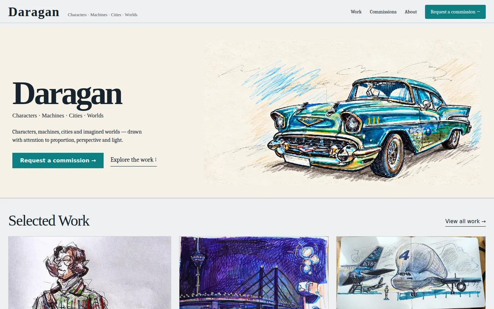
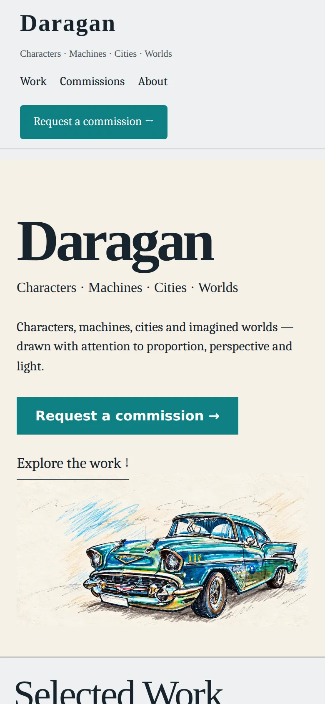
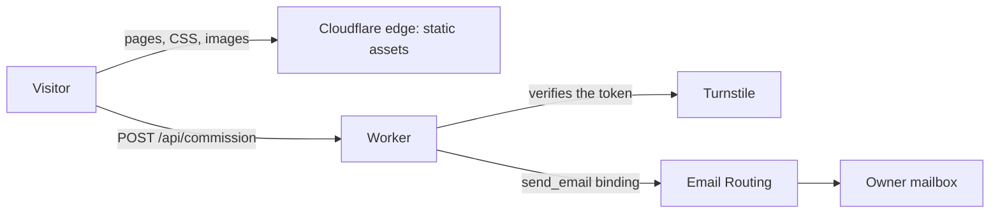

# DARAGAN

[](https://github.com/DaraganM/daragan-art/actions/workflows/ci.yml)
[](LICENSE)
[](LICENSE-ARTWORK.md)

Portfolio and commissions website for the artist Mykhailo Daragan, live at **[daragan.art](https://daragan.art)**.

<p>
  
  
</p>

## The brief

An artist with a physics background needed a professional online presence that shows the work, turns visitors into commission requests, and can grow into a shop later, with fixed running costs close to the price of a domain name.

## What was built

A static-first site served from Cloudflare's edge, plus **one** small Worker for the commission form. There is no database, no always-on server and no third-party mail or form service.

| Layer | Choice |
|---|---|
| Site | [Astro](https://astro.build) with static output, hand-written CSS, no client-side framework |
| Hosting | Cloudflare Workers Static Assets on a custom domain |
| Commission form | One Worker: validation, honeypot, Cloudflare Turnstile, delivery by e-mail through Cloudflare Email Routing |
| Domain and DNS | Porkbun registrar, Cloudflare DNS |
| Quality gates | GitHub Actions (build, Worker dry run, secret scan) and Dependabot |
| Fixed cost | About $21 a year (the domain renewal). Hosting, e-mail and spam protection run on free tiers |



## Design principles

- **Design for extension, build for today's scale, pay only for today's scale.**
- **Cost gate.** No external service is added without answering why it is needed, what the free option and its limit are, what triggers an upgrade, how to migrate away and how locked in the project would be. Every choice is recorded in [docs/decisions.md](docs/decisions.md).
- **No premature infrastructure.** No databases, queues or microservices until a measured need exists.
- **Secrets stay out of Git.** They live in the Worker secret store, and the owner's mailbox never appears in the repository.

## Features

- Pages: home, Work (one section per category), Visual Thinking (drawings as short case studies), Lab (Python, data and AI experiments, each labelled own project, exploration or fork), About, Commissions, plus thanks and 404.
- Content is data: adding a work or a Lab project is a JSON entry plus image files ([docs/content-guide.md](docs/content-guide.md)). The build fails if a fork lacks its upstream credit or an image is missing.
- Commissions page with a request form: server-side validation, honeypot, Turnstile check, delivery by e-mail.
- Responsive from 320 px, visible keyboard focus, reduced-motion preference respected.
- SEO basics: canonical URLs, Open Graph and Twitter cards, sitemap, robots.txt.
- Security headers, including a restrictive Content Security Policy ([`public/_headers`](public/_headers)).
- One stylesheet of about 500 lines ([`src/styles/global.css`](src/styles/global.css)) with no `!important` and non-overlapping viewport ranges.

## Run it locally

Requires Node.js 22.12 or newer.

```bash
npm ci
npm run dev            # the site only; the form needs the Worker

cp .dev.vars.example .dev.vars
npm run cf:dev         # site and Worker together, with the form
```

## Deploy

[docs/deploy.md](docs/deploy.md) covers the one-time Cloudflare setup, secrets, releases and rollback.

## Content

- **Works:** add web-sized WebP files to `public/works/` and an entry to `src/data/works.json` with a `group` (an id from `src/data/groups.json`). It then appears on the home page and in its section of the Work page. To place it in the home grid, add a `.work-card-<slug>` rule (grid area) to `src/styles/global.css`; without one it takes the next free cell. Delete files that are no longer used, because everything in `public/` is deployed.
- **Categories:** `src/data/groups.json` (title, blurb, cover image).
- **Visual Thinking and Lab:** `src/data/visual-thinking.json` and `src/data/lab.json`, described in [docs/content-guide.md](docs/content-guide.md).
- **Social links:** `src/data/social.json`. **GitHub and LinkedIn links on the About page:** `src/data/profile.json` (an empty value hides the link).

## Repository layout

```text
.
├── src/
│   ├── pages/              home, work, visual-thinking, lab, about, commissions, thanks, 404
│   ├── layouts/Base.astro  page shell, meta tags, footer
│   ├── components/         SocialLinks, VisualWorkCard, LabProjectCard
│   ├── lib/work-image.js   image sizes read from the files at build time
│   ├── data/               works, groups, visual-thinking, lab, social, profile (JSON)
│   └── styles/global.css   the only stylesheet
├── public/                 static files: works/ (WebP), _headers, robots.txt, icons
├── worker/index.js         the only server-side code: POST /api/commission
├── docs/                   decision log, deploy runbook, screenshots
├── wrangler.jsonc          Cloudflare configuration (no secrets)
└── .github/                CI workflow, Dependabot
```

## Roadmap

- [ ] German, Ukrainian and Russian versions
- [ ] Online orders and payments for prints and originals
- [ ] Original Lab projects, each with a visual case study
- [ ] Lighthouse and accessibility checks in CI

## Licence and credits

Code: [MIT](LICENSE). Artwork, photographs and the DARAGAN name: Copyright (c) 2026 Mykhailo Daragan, all rights reserved ([details](LICENSE-ARTWORK.md)). Social icons: [Simple Icons](https://simpleicons.org), CC0.
